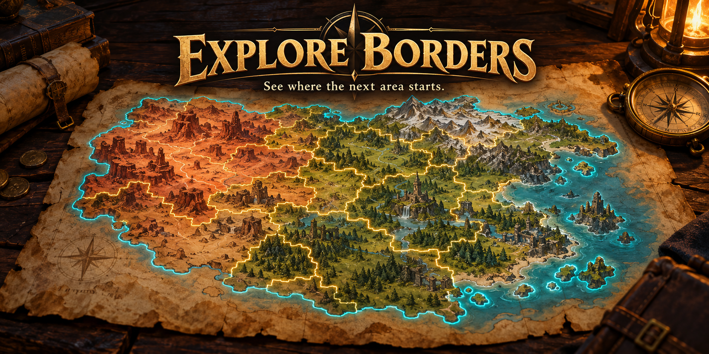
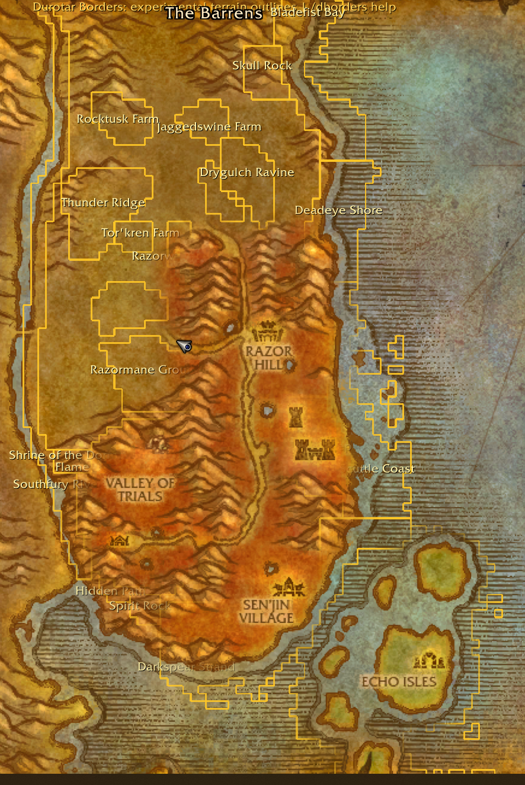

# Explore Borders

Shows area boundaries on your world map so you can see where to run when exploring, instead of guessing where an area starts.

Made for **WoW Forever**. No extra addons needed.

**[Download Explore Borders 0.2.0](https://github.com/Hacker--x/ExploreBorders/releases/download/v0.2.0/ExploreBorders-0.2.0.zip)** · [Coverage](COVERAGE.txt) · [Report a problem](https://github.com/Hacker--x/ExploreBorders/issues)

## What the lines mean

- **Gold:** subarea boundaries.
- **Cyan:** the outer zone boundary.
- Names can be turned off if the map gets crowded.

Includes **812 subarea outlines** and **59 zone perimeters**, covering **48 named maps**, with another **11 instance datasets** matched through the game's map API. Instance support still needs in-game testing. Some maps only have an outer perimeter; [the coverage list](COVERAGE.txt) shows exactly what's included.

## Install

1. Download the ZIP linked above.
2. Close WoW.
3. Extract the **ExploreBorders** folder into your Forever client's `Interface\AddOns` folder.
4. Start the game, enable **Explore Borders**, and open a covered zone on the world map.

You should end up with:

```text
Interface/
  AddOns/
    ExploreBorders/
      ExploreBorders.toc
```

If you used the original Durotar Borders version, remove its old addon folder. This download is standalone—just ExploreBorders.

Use the release ZIP, rather than GitHub's **Code → Download ZIP**, for the ready-to-install addon.

## Commands

| Command | What it does |
| --- | --- |
| `/eborders` | Turn the outlines on or off |
| `/eborders show` | Turn them on |
| `/eborders hide` | Turn them off |
| `/eborders labels` | Show or hide area names |
| `/eborders perimeters` | Show or hide the cyan zone borders |
| `/eborders status` | Show the current map's coverage and diagnostic details |
| `/eborders mark before` | Save your position with a note for testing a crossing |

`/exploreborders` works too. The old `/dborders` command is still supported.

## In game



*Actual screenshot of the original Durotar prototype. The image still has the old addon name; the current release is Explore Borders and adds other maps and cyan zone perimeters. Cover art at the top is generated promotional artwork, not a game screenshot.*

## A few things to know

These are **terrain boundaries**, so discovery may not trigger exactly on the line everywhere. Rendering worked in the Durotar test, but that doesn't confirm every discovery trigger or every other map.

- Lines stay visible whether you've explored an area or not.
- Not every named subarea gives discovery credit.
- Caves, buildings, floors, phases and height rules aren't fully represented.
- Ironforge, Undercity and several interiors have no geometry in the source.
- The detailed outlines appear on zone maps, not the continent/world overview.
- Built for the standard Blizzard world map; map replacements haven't been tested.

If something looks off, [open an issue](https://github.com/Hacker--x/ExploreBorders/issues) with the zone, a screenshot, your client build, and the output of `/eborders status`.

## Source and testing

Boundary data comes from [WoW Forever Map](https://wowforevermap.com/). The source doesn't identify its client build. [SOURCES.txt](SOURCES.txt) records the URLs, coordinate conversion and validation details.

All 812 subareas and 59 perimeters match their published terrain-cell counts after grid recovery. The Lua mock tests cover map switching, clipping, resizing, fallback coordinates, settings and position marks. Those tests don't replace in-game checks.

Run the tests from this repository with a Lua interpreter:

```sh
lua ExploreBorders.test.lua
```

Build the standalone install ZIP with Python 3:

```sh
python package.py
```

The current package targets interface **16001** and makes no network requests at runtime.
